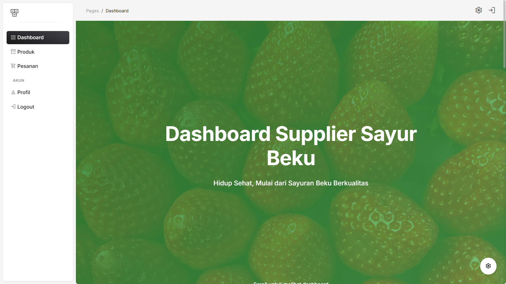
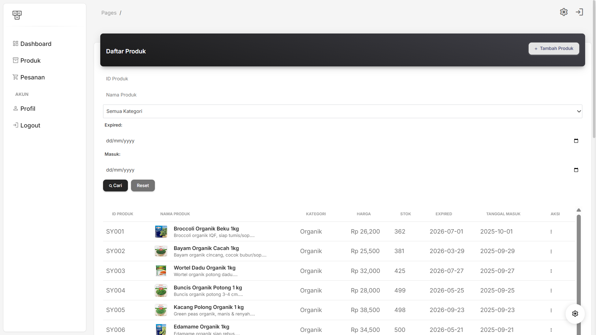
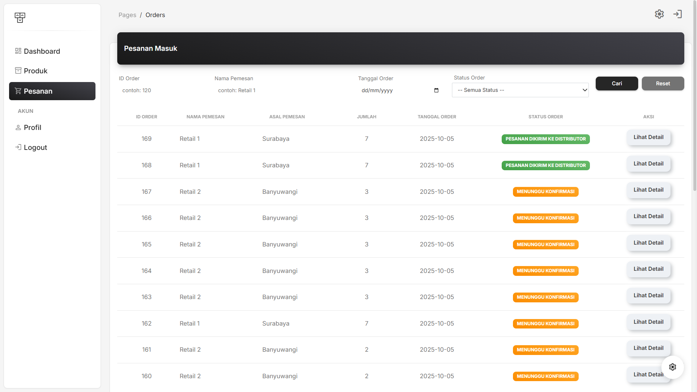
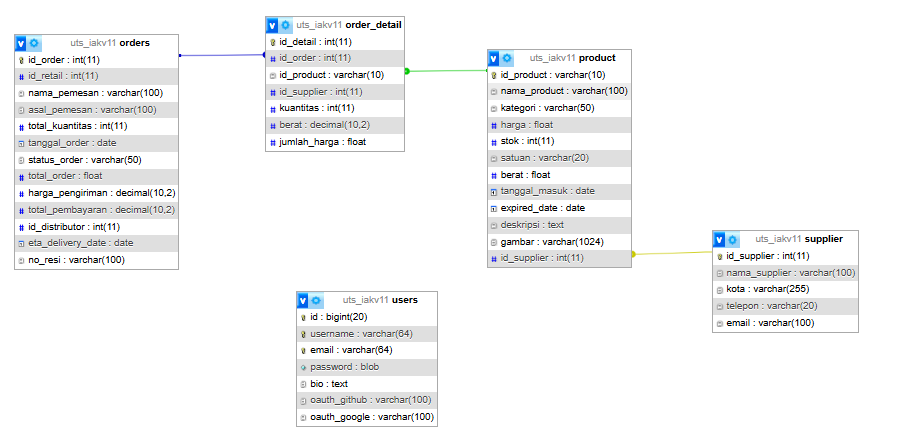

# Supply Chain Management — Supplier Integration Module

## Gambaran Proyek

**Supplier Integration Module** merupakan aplikasi web berbasis **Python, Flask, dan MySQL** yang dikembangkan untuk menyimulasikan integrasi proses bisnis dalam sistem *Supply Chain Management* (SCM). Sistem menghubungkan tiga modul independen, yaitu **Retail, Supplier, dan Distributor**, melalui REST API, pertukaran data JSON, serta mekanisme callback untuk mengoordinasikan proses pemesanan dan pengiriman barang.

Dalam skenario ini, modul Supplier merepresentasikan **CV Sehat Sayur Sejahtera**, sebuah perusahaan pemasok sayuran beku yang berlokasi di Malang. Supplier bertanggung jawab untuk mengelola produk dan persediaan, menerima pesanan dari Retail, melakukan validasi stok, meminta penawaran biaya pengiriman, serta meneruskan pesanan kepada Distributor yang dipilih Retail. Dua Distributor yang terlibat dalam simulasi pengujian adalah **PT Kuda Lumping Angkasa Tbk** dan **PT Ikan Terbang Makmur Sejahtera TBK**.

Proyek ini dikembangkan oleh **Kelompok B** sebagai *team-based project* untuk **Ujian Tengah Semester (UTS) mata kuliah Integrasi Aplikasi Korporasi, Program Studi S1 Teknologi Sains Data, Universitas Airlangga, tahun 2025**. Modul Retail, Supplier, dan Distributor dikembangkan oleh tim berbeda, kemudian diintegrasikan untuk menguji komunikasi dan pertukaran data antarsistem.

**Teknologi utama:** Python, Flask, MySQL, REST API, JSON, JavaScript, ngrok.

### Tampilan Dashboard Supplier

Dashboard Supplier menjadi pusat pengelolaan produk dan pemantauan pesanan yang diterima dari Retail. Melalui antarmuka ini, pengguna dapat mengakses informasi produk, melihat pesanan, serta menerima notifikasi aktivitas yang diproses melalui API.



---

## Fitur Utama

### 1. Manajemen Produk dan Persediaan

Modul Supplier menyediakan fitur **Create, Read, Update, dan Delete (CRUD)** untuk mengelola informasi produk sayuran beku. Setiap produk memiliki atribut seperti nama, kategori, harga, berat, stok, tanggal masuk, dan tanggal kedaluwarsa.

Pengguna dapat menambahkan produk baru, memperbarui informasi produk, menghapus produk, serta melakukan penambahan persediaan. Dalam rancangan sistem, penambahan stok dilakukan ketika stok sebelumnya habis, sehingga dapat merepresentasikan batch persediaan baru dengan tanggal kedaluwarsa yang berbeda.

Informasi produk juga disediakan melalui endpoint `/api/products` agar Retail dapat memperoleh daftar produk, harga, dan stok sebelum melakukan pemesanan.



### 2. Penerimaan dan Pemrosesan Pesanan Retail

Proses pemesanan dimulai ketika Retail mengirimkan request ke endpoint `POST /api/pesanan_retail`. Request menggunakan format JSON yang memuat identitas Retail (`id_retail`) serta daftar produk dan kuantitas yang dipesan (`items`).

Backend Supplier memeriksa kelengkapan data, memastikan produk tersedia, dan memvalidasi kecukupan stok. Jika validasi berhasil, pesanan dicatat pada tabel `orders` dan rinciannya disimpan pada tabel `order_detail`, dengan status awal **Menunggu Konfirmasi**.

Sistem juga menghitung `total_order` berdasarkan harga dan kuantitas setiap produk serta `total_kuantitas` sebagai jumlah keseluruhan barang yang dipesan. Informasi tersebut digunakan dalam permintaan penawaran biaya pengiriman dan pemrosesan pesanan selanjutnya.



### 3. Integrasi Penawaran Ongkos Kirim

Setelah pesanan berhasil diterima, Supplier mengirimkan permintaan penawaran biaya pengiriman kepada sistem Distributor yang terhubung. Permintaan mencakup kota asal Supplier, kota tujuan Retail, dan jumlah barang yang akan dikirim.

Dalam skenario pengujian, permintaan dikirim kepada dua Distributor, yaitu PT Kuda Lumping Angkasa Tbk dan PT Ikan Terbang Makmur Sejahtera TBK. Masing-masing Distributor mengembalikan respons yang berisi informasi biaya dan estimasi pengiriman.

Supplier kemudian mengumpulkan respons tersebut dalam struktur `ekspedisi_results` dan mengirimkan daftar pilihan Distributor kepada Retail melalui callback `/api/orders/order-callback`.

Mekanisme ini memungkinkan Retail menerima beberapa opsi pengiriman dan memilih Distributor berdasarkan informasi biaya serta estimasi yang tersedia.

### 4. Pemrosesan Pengiriman dan Pembaruan Pesanan

Setelah menentukan pilihan, Retail mengirimkan `id_order` dan `id_distributor` melalui endpoint `POST /api/pesanan_distributor`. Supplier menggunakan informasi tersebut untuk mengambil data pesanan dan meneruskan rincian barang kepada Distributor yang dipilih.

Distributor kemudian mengembalikan respons yang mencakup status pemrosesan, `biaya_pengiriman`, `eta_delivery_date`, dan `no_resi`. Backend Supplier menyimpan informasi tersebut ke database, menghitung total pembayaran dengan menjumlahkan harga produk dan biaya pengiriman, serta memperbarui status pesanan menjadi **Pesanan Dikirim ke Distributor**.

Pada tahap ini, stok produk dikurangi sesuai kuantitas yang dipesan. Supplier juga mengirimkan callback ke endpoint Retail `/api/orders/resi` agar Retail menerima informasi total pembayaran dan nomor resi pengiriman.

Detail pesanan dan informasi pengiriman dapat diperiksa melalui halaman pesanan pada dashboard Supplier.


### 5. Notifikasi Aktivitas Pesanan

Modul Supplier dilengkapi mekanisme notifikasi untuk menampilkan pembaruan proses pemesanan pada dashboard. Notifikasi dihasilkan oleh backend melalui fungsi `push_notification()` dan dapat diambil oleh frontend melalui endpoint `/api/notifications`. Notifikasi mencakup aktivitas penting, seperti pesanan baru yang dikirimkan Retail kepada Supplier, respons penawaran biaya pengiriman dari Distributor, dan konfirmasi bahwa pesanan telah diteruskan kepada Distributor terpilih.

**Notifikasi Pesanan Baru dari Retail**

Ketika Retail mengirim pesanan baru melalui API dan Supplier memprosesnya, dashboard menampilkan popup yang memberitahukan adanya pesanan masuk.


**Notifikasi Penerusan Pesanan ke Distributor**

Setelah Supplier memproses pemilihan Distributor dan memperoleh konfirmasi pemrosesan pengiriman, dashboard menampilkan notifikasi pembaruan pesanan.


---

## Alur Integrasi Antarsistem

Integrasi ketiga modul mengikuti alur komunikasi berikut:

1. **Retail → Supplier:** Retail mengirimkan pesanan berisi identitas pemesan, produk, dan kuantitas.
2. **Supplier:** Backend memvalidasi produk dan stok, menghitung nilai pesanan, lalu menyimpan data ke database.
3. **Supplier → Distributor:** Supplier meminta penawaran biaya pengiriman kepada Distributor yang terhubung.
4. **Distributor → Supplier:** Distributor mengembalikan biaya dan estimasi pengiriman.
5. **Supplier → Retail:** Supplier mengirimkan pilihan Distributor beserta penawaran ongkos kirim melalui callback.
6. **Retail → Supplier:** Retail memilih Distributor yang akan menangani pengiriman.
7. **Supplier → Distributor terpilih:** Supplier meneruskan rincian pesanan dan informasi tujuan pengiriman.
8. **Distributor → Supplier:** Distributor mengembalikan konfirmasi, biaya pengiriman, estimasi kedatangan, dan nomor resi.
9. **Supplier → Retail:** Supplier memperbarui informasi pesanan serta stok, kemudian mengirimkan total pembayaran dan nomor resi kepada Retail.

Aktivitas yang relevan selama proses tersebut menghasilkan notifikasi pada dashboard Supplier.

## REST API

Modul Supplier menyediakan **empat endpoint API utama**, terdiri atas dua endpoint GET dan dua endpoint POST. Selain itu, terdapat endpoint pendukung untuk pengambilan notifikasi.

| Method | Endpoint | Fungsi |
|---|---|---|
| GET | `/api/suppliers` | Menyediakan identitas dan kota asal Supplier kepada Retail |
| GET | `/api/products` | Menyediakan daftar produk, harga, stok, dan tanggal kedaluwarsa |
| POST | `/api/pesanan_retail` | Menerima pesanan Retail, memvalidasi data, menyimpan order, dan memproses permintaan ongkos kirim |
| POST | `/api/pesanan_distributor` | Menerima pilihan Distributor dan meneruskan pesanan |
| GET | `/api/notifications` | Menyediakan informasi notifikasi untuk dashboard Supplier |

### Pengujian API

Pengujian request dan response API dilakukan menggunakan Postman untuk memeriksa komunikasi antarmodul serta struktur data JSON.


### Contoh Request Pesanan Retail

Endpoint: `POST /api/pesanan_retail`

```json
{
  "id_retail": 2,
  "items": [
    {
      "id_product": 1,
      "qty": 10
    },
    {
      "id_product": 2,
      "qty": 10
    }
  ]
}
```

Request tersebut merepresentasikan pemesanan dua jenis produk, masing-masing sebanyak 10 unit. Supplier memvalidasi kedua produk, menyimpan informasi pesanan, dan menghitung total kuantitas sebelum melanjutkan proses integrasi.

### Contoh Pemilihan Distributor

Endpoint: `POST /api/pesanan_distributor`

```json
{
  "id_order": 214,
  "id_distributor": 1
}
```

Dalam skenario pengujian, ID Distributor `1` merepresentasikan PT Kuda Lumping Angkasa Tbk.

Setelah pesanan diteruskan, Distributor mengembalikan informasi pengiriman, misalnya:

```json
{
  "status": "success",
  "biaya_pengiriman": 500500,
  "eta_delivery_date": "2025-10-09",
  "no_resi": "RESI-20251006-704AAD"
}
```

Supplier kemudian menyimpan informasi tersebut dan mengirimkan callback kepada Retail melalui `/api/orders/resi`.

### Callback ke Modul Retail

| Endpoint Tujuan | Fungsi |
|---|---|
| `/api/orders/order-callback` | Mengirimkan opsi Distributor, biaya pengiriman, dan informasi pesanan |
| `/api/orders/resi` | Mengirimkan total pembayaran dan nomor resi setelah pemrosesan pengiriman |

Contoh payload berasal dari skenario pengujian pada laporan proyek dan tidak merepresentasikan transaksi komersial.

---

## Struktur Database

Modul Supplier menggunakan **MySQL** untuk menyimpan data produk, pengguna, dan transaksi pemesanan.

Database terdiri atas beberapa tabel utama:

| Tabel | Fungsi |
|---|---|
| `supplier` | Menyimpan identitas, kota asal, dan informasi kontak Supplier |
| `product` | Menyimpan nama, kategori, harga, stok, berat, dan informasi kedaluwarsa produk |
| `orders` | Menyimpan informasi utama pesanan dan status pemrosesannya |
| `order_detail` | Menyimpan rincian produk, kuantitas, dan harga pada setiap pesanan |
| `users` | Menyimpan informasi akun pengguna aplikasi |

Tabel `orders` dan `order_detail` digunakan untuk merepresentasikan hubungan antara satu pesanan dan beberapa produk yang dipesan. Hubungan dengan tabel `product` mendukung validasi produk, perhitungan transaksi, serta pembaruan persediaan.



## Integration Testing & Debugging

Pengujian integrasi dilakukan bersama tim pengembang modul Retail dan Distributor untuk memastikan komunikasi REST API, kesesuaian struktur JSON, dan alur pemrosesan pesanan berjalan sesuai rancangan. Pengujian mencakup penerimaan pesanan dari Retail, validasi produk dan stok, permintaan penawaran ongkos kirim, pengolahan respons dari beberapa Distributor, pengiriman callback, pemrosesan pilihan Distributor, serta pembaruan status pesanan dan resi. Selain pengujian komunikasi API, fungsionalitas dashboard diperiksa untuk memastikan informasi pesanan dan popup notifikasi dapat ditampilkan berdasarkan aktivitas yang diproses backend.

**Hasil pengujian digunakan untuk melakukan debugging dan penyempurnaan logika backend**, termasuk perbaikan pemrosesan order, penanganan respons API, dan integrasi notifikasi dengan frontend. Pengujian dilakukan dalam lingkungan pengembangan menggunakan **ngrok** agar aplikasi yang dijalankan oleh tim berbeda dapat saling berkomunikasi melalui endpoint HTTP.

## Teknologi yang Digunakan

| Teknologi | Penggunaan |
|---|---|
| Python & Flask | Backend aplikasi, pengembangan endpoint API, dan pemrosesan pesanan |
| MySQL | Database produk, Supplier, dan transaksi |
| REST API & JSON | Komunikasi serta pertukaran data antarmodul |
| HTML, CSS, JavaScript | Antarmuka dashboard dan notifikasi |
| Flask Material Dashboard | Template dasar antarmuka web |
| Postman | Pengujian endpoint API |
| ngrok | Koneksi antarsistem selama pengujian |
| Git & GitHub | Version control dan kolaborasi |

## Tim Pengembang

Modul Supplier dikembangkan oleh **Kelompok B**, yang terdiri dari:

- Aura Najma Kustiananda
- Fitra Shafa Humaira
- Pradipta Deska Pryanda
- Ulvi Azzahra

## Catatan Proyek

Supplier Integration Module dikembangkan sebagai simulasi akademik integrasi aplikasi korporasi. Identitas perusahaan, produk, transaksi, dan pengiriman yang digunakan dalam skenario pengujian bersifat simulasi, bukan aktivitas komersial perusahaan sebenarnya.

Antarmuka aplikasi menggunakan Flask Material Dashboard sebagai template dasar, dengan penyesuaian fitur sesuai kebutuhan modul Supplier. Lisensi dan atribusi komponen template tetap mengacu pada proyek asal.
